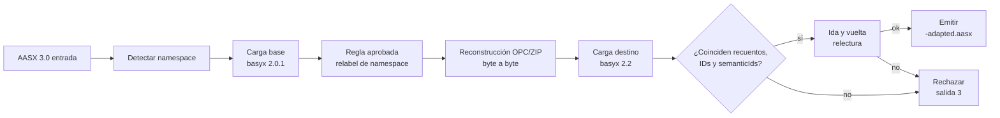
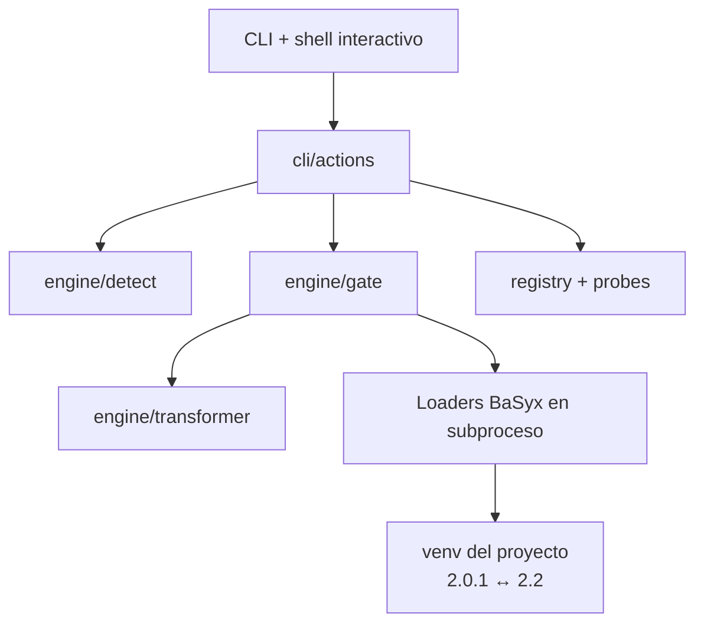

<div align="center">

<!-- Espacio reservado para la figura: descomentar cuando existan docs/assets/readme-hero-light.webp y -dark.webp.
<picture>
  <source media="(prefers-color-scheme: dark)" srcset="docs/assets/readme-hero-dark.webp">
  <source media="(prefers-color-scheme: light)" srcset="docs/assets/readme-hero-light.webp">
  
</picture>
-->

<h1>AAS Bridge</h1>

<p><strong>Migra paquetes AASX entre versiones del metamodelo AAS — y demuestra que no se ha perdido nada.</strong></p>

<p>
  
  
  <a href="LICENSE"></a>
  
  
</p>

<p>
  <a href="#inicio-rápido">Inicio rápido</a> ·
  <a href="#comandos">Comandos</a> ·
  <a href="#la-puerta-de-evidencia">Puerta de evidencia</a> ·
  <a href="#compatibilidad">Compatibilidad</a> ·
  <a href="#conocimiento-del-ecosistema">Ecosistema</a> ·
  <a href="#hoja-de-ruta">Hoja de ruta</a> ·
  <a href="#contribuir">Contribuir</a>
</p>

<p><a href="README.md">English</a> · <strong>Español</strong></p>

</div>

AAS Bridge es una herramienta de línea de comandos para la **Asset Administration
Shell (AAS)**. Su objetivo es un fallo silencioso: un paquete **AASX** creado para una
versión del metamodelo puede cargarse como un almacén de objetos vacío cuando lo lee
otra generación del SDK de Eclipse BaSyx, sin lanzar ninguna excepción. AAS Bridge
nombra el desajuste, aplica solo una transformación aprobada y se niega a emitir un
fichero que no puede demostrar.

**Detecta** la versión · **Diagnostica** la cadena de herramientas · **Migra** con una regla aprobada · **Demuestra** el resultado.

> **Estado:** `0.2.0` alpha. El núcleo headless y la CLI ya están disponibles; la GUI
> local, el downgrade y el pipeline de ingesta están en la [hoja de ruta](#hoja-de-ruta).

¿Nuevo en AAS? Empieza por el [metamodelo AAS de IDTA](https://github.com/admin-shell-io/aas-specs-metamodel)
y el [SDK Python de Eclipse BaSyx](https://github.com/eclipse-basyx/basyx-python-sdk).

## Inicio rápido

### Requisitos

- Python 3.11 o superior.
- `git` y `pip`.
- Puede que necesites acceso a red la primera vez que migras un paquete nuevo: la
  puerta instala el SDK de BaSyx del dialecto de origen para construir la base. Las
  bases se cachean, así que las migraciones repetidas del mismo paquete funcionan
  offline.

> [!IMPORTANT]
> Usa un entorno virtual dedicado. La puerta de evidencia intercambia temporalmente
> `basyx-python-sdk` en el entorno activo para cargar el dialecto de origen y después
> restaura `basyx-python-sdk~=2.2`.

### Instalar desde el código fuente

AAS Bridge todavía no está publicado en PyPI. Instálalo desde un clon:

<!-- Sustituye OWNER/REPO por el slug público del repositorio antes de publicar. -->
```bash
git clone https://github.com/OWNER/REPO.git aas-bridge
cd aas-bridge
python -m venv .venv
```

Activa el entorno:

```bash
# macOS / Linux
source .venv/bin/activate
```

```powershell
# Windows (PowerShell)
.venv\Scripts\Activate.ps1
```

Después instala y comprueba la versión:

```bash
pip install .
aas-bridge --version
```

Resultado esperado: `aas-bridge 0.2.0`.

### Diagnosticar un paquete

```bash
aas-bridge check ruta/a/tu-paquete.aasx
```

### Migrarlo

```bash
aas-bridge migrate ruta/a/tu-paquete.aasx --report ruta/al/informe.json
```

El paquete adaptado se escribe junto al fichero de entrada como
`tu-paquete-adapted.aasx`. El fichero de entrada nunca se modifica.

### Qué ocurre con tu fichero

| Situación | Resultado |
|---|---|
| Paquete AAS 3.0 XML | Se migra y se escribe como `<name>-adapted.aasx` |
| Ya es AAS 3.1 | Sin fichero de salida, sin ejecutar la puerta, salida `0` |
| Partes AAS JSON | Se detectan, pero `migrate` las rechaza (salida `1`) |
| Fallo de la puerta de evidencia | Sin fichero de salida; salida `3` |
| Versión no detectable o incoherente | Se rechaza con una explicación; salida `1` |

> [!NOTE]
> La primera migración de un paquete nuevo puede necesitar acceso a red. La base se
> cachea bajo `AASBRIDGE_CACHE_DIR`; las ejecuciones repetidas del mismo paquete
> funcionan offline.

## Verlo en acción

```console
$ mkdir work
$ cp aas_v3-0/CeDRI_PunchingMachine_instanceA.aasx work/
$ aas-bridge check work/CeDRI_PunchingMachine_instanceA.aasx --lang es
AAS Bridge — diagnóstico del paquete
Fichero: work/CeDRI_PunchingMachine_instanceA.aasx
Detectado: AAS 3.0
Partes AAS: 1
  - /aasx/IndustrialRobot_ABB_CeDRI/IndustrialRobot_ABB_CeDRI.aas.xml (xml, https://admin-shell.io/aas/3/0)
Objetivo: AAS 3.1
Actualización disponible: sí (cambio de namespace 3/0 → 3/1)

$ aas-bridge migrate work/CeDRI_PunchingMachine_instanceA.aasx --report work/machine.report.json --lang es
AAS Bridge — migración
Estado: migrado (puerta de evidencia superada)
Origen: work/CeDRI_PunchingMachine_instanceA.aasx
Base: 22 objetos (1 AAS / 6 SM / 15 CD) con basyx 2.0.1
Objetivo: 22 objetos (1 AAS / 6 SM / 15 CD) con basyx 2.2.0
Reglas aplicadas: v3_0_to_v3_1/namespace-relabel
Puerta: SUPERADA (ida y vuelta correcta)
Salida: work/CeDRI_PunchingMachine_instanceA-adapted.aasx
Informe: work/machine.report.json
```

El ejemplo usa el corpus incluido. El corpus es de solo lectura: copia un paquete a
un directorio de trabajo antes de migrarlo (en Windows PowerShell, usa `Copy-Item`
en lugar de `cp`).

## Por qué AAS Bridge

### El fallo es silencioso

`basyx-python-sdk` solo reconoce un único namespace AAS. No negocia versiones. Cuando
un paquete declara otro distinto, el cargador registra un error de namespace y devuelve
un **almacén de objetos vacío** — sin lanzar una excepción. En un pipeline, eso
parece un modelo vacío válido; en SMIA, aparece como un error genérico de modelo que
nunca menciona la versión.

Ese es el fallo que AAS Bridge existe para evitar. Hace explícito el desajuste y te
da un fichero que la cadena de herramientas de destino puede leer de verdad, con
evidencia de que el modelo sobrevivió.

### En qué puedes confiar

| Principio | Qué significa en la práctica |
|---|---|
| **Evidencia antes que confianza** | El fichero original y el adaptado se cargan con sus respectivos dialectos de BaSyx; los recuentos de objetos, identificadores y semanticIds deben coincidir, y el resultado debe sobrevivir a una ida y vuelta. |
| **Preservación byte a byte** | Solo cambian las declaraciones de namespace. La reconstrucción OPC/ZIP copia byte a byte cada parte no tocada: ontologías OWL, diagramas BPMN, propiedades, miniaturas, relaciones y content types. |
| **Fail-closed** | Versión desconocida, payload JSON, regla no aprobada, base vacía o puerta fallida → se rechaza y se explica. Sin salida parcial. |
| **La entrada nunca se modifica** | La herramienta opera sobre una copia y escribe un nuevo `<name>-adapted.aasx` junto a ella. |
| **Offline-first** | `check`, `migrate` con bases cacheadas, la guía de SMIA instalada y el shell funcionan offline. Las funciones online degradan de forma visible, nunca silenciosa. |
| **basyx es el único validador** | AAS Bridge no aprende ningún metamodelo propio; el SDK del dialecto de destino instalado decide qué es válido. |

**Para quién es:** usuarios de SMIA (el runtime AAS para el que se construyó esta
herramienta), integradores de AAS que mantienen fábricas con versiones mixtas y
autores de toolchains que necesitan conversiones auditables.

**No es un conversor genérico:** AAS Bridge es un motor de reglas por par de
versiones, aprobadas por humanos. AAS 2.0 ↔ 3.x y las conversiones entre
subversiones están fuera de alcance (ver [Compatibilidad](#compatibilidad)).

## Comandos

| Comando | Qué hace | Red |
|---|---|---|
| `aas-bridge check <file>` | Nombra la versión AAS, lista las partes AAS e indica si hay una migración disponible. | No |
| `aas-bridge migrate <file>` | Ejecuta la migración AAS 3.0 → 3.1 con puerta de evidencia y escribe `<name>-adapted.aasx`. | Primera ejecución por paquete |
| `aas-bridge smia [file]` | Resuelve la versión de SMIA que ejecutas y da un veredicto honesto por fichero. Nunca escribe ficheros. | Opcional |
| `aas-bridge update` | Comprueba las releases oficiales de IDTA y descarga los artefactos fijados con un manifiesto de hashes. | Opcional |
| `aas-bridge` / `aas-bridge shell` | Abre el shell interactivo. | No |

Opciones:

| Flag | Se aplica a | Significado |
|---|---|---|
| `--lang {en,es}` | `check`, `migrate`, `smia`, `update` | Idioma de salida; por defecto, el locale del sistema si es inglés o español; si no, inglés. |
| `--report <path>` | `migrate` | Escribe el informe JSON determinista de la migración. |
| `--version` | Global | Muestra `aas-bridge <version>` y termina. |

### Códigos de salida

| Código | Significado |
|---|---|
| `0` | Éxito, incluido "ya es AAS 3.1 — no se necesita migración" y el estado offline de `update` |
| `1` | Error de usuario/entrada: fichero ausente, no es un AASX, versión no detectable, partes JSON |
| `2` | Error de uso |
| `3` | Fallo de la puerta de evidencia |
| `4` | Error interno |

`smia` sale con `0` siempre que produce un diagnóstico, incluido el estado visible
`unverified`, y `1` solo si falta el fichero o no se puede detectar. `update` sale
con `0` cuando se ejecuta, incluido el estado degradado offline; los fallos de
comprobación y descarga son estados por ítem, no fallos del proceso. `check` sale con
`0` siempre que puede informar de una versión, incluidos los paquetes JSON con una
nota de solo detección; `migrate` sale con `1` para las partes JSON. El shell siempre
sale con `0` en `exit`/`quit`, EOF o Ctrl+C; los fallos de un comando imprimen un
error y el bucle continúa.

### Ejemplos

```bash
aas-bridge check machine.aasx --lang es
aas-bridge migrate machine.aasx --report reports/machine.json
aas-bridge smia machine.aasx
aas-bridge update
```

<details>
<summary>Shell interactivo</summary>

El comando `aas-bridge` sin argumentos (o `aas-bridge shell`) abre un shell de la
biblioteca estándar — sin dependencias extra. El banner bilingüe solo se muestra al
entrar; el prompt es `aas-bridge> `.

```text
check <file>                        diagnostica un paquete AASX
migrate <file> [--report <path>]    migra con la puerta de evidencia
smia [file]                         guía de SMIA y veredicto por fichero
update                              comprobación de releases + descarga de artefactos
lang [en|es]                        muestra o cambia el idioma de la sesión
version                             muestra la versión de la herramienta
help [command]                      muestra la ayuda
exit | quit                         sale del shell
```

Entrecomilla las rutas con espacios (`migrate "C:\dir with space\f.aasx"`); las
barras invertidas de Windows se conservan. Un comando fallido imprime su error y el
shell sigue funcionando.

</details>

<details>
<summary>Entorno y directorios de datos</summary>

| Variable | Valor por defecto |
|---|---|
| `AASBRIDGE_CACHE_DIR` | `%LOCALAPPDATA%\aasbridge\cache` en Windows; `~/.cache/aasbridge` en el resto |
| `AASBRIDGE_REGISTRY_DIR` | `%LOCALAPPDATA%\aasbridge\registry` en Windows; `~/.local/share/aasbridge/registry` en el resto |

La caché guarda las bases de la puerta; el registro guarda los artefactos oficiales
descargados por `update`.

</details>

## La puerta de evidencia

Una migración es una afirmación. La puerta es cómo AAS Bridge la demuestra.



Para cada migración AAS 3.0 → 3.1, AAS Bridge:

1. carga el original con el dialecto de origen (`basyx-python-sdk==2.0.1`) y registra
   los recuentos de objetos (AAS / Submodels / ConceptDescriptions), un hash de los
   identificadores ordenados y un hash de los semanticIds ordenados. Una base de cero
   objetos es un fallo, nunca un éxito;
2. aplica solo la regla aprobada (`v3_0_to_v3_1/namespace-relabel`) y reconstruye el
   paquete OPC/ZIP, copiando byte a byte cada parte no tocada;
3. carga el paquete adaptado con el dialecto de destino (`basyx-python-sdk~=2.2`) y
   verifica que el SDK instalado declara el namespace de destino;
4. vuelve a serializar y a cargar el almacén de objetos como comprobación de ida y
   vuelta;
5. emite el fichero adaptado solo cuando el destino reproduce la base y la ida y
   vuelta tiene éxito. En caso contrario, elimina el fichero y el comando sale con
   `3`.

> [!WARNING]
> Si cualquier comprobación falla, el fichero adaptado se elimina y el comando sale
> con código `3`. No hay salida parcial.

<details>
<summary>Cómo funciona el intercambio de dialecto</summary>

La puerta intercambia `basyx-python-sdk` en el entorno virtual del proyecto y ejecuta
cada carga de BaSyx en un subproceso. El proceso principal nunca importa el SDK, así
que no puede quedarse con una versión obsoleta en `sys.modules`. El entorno siempre
se restaura a `basyx-python-sdk~=2.2` en un bloque `finally`. Las ejecuciones de la
puerta se serializan con un fichero de lock y las bases se cachean por hash del
fichero y requisito de dialecto bajo `AASBRIDGE_CACHE_DIR`.

</details>

<details>
<summary>Esquema del informe (ejemplo recortado)</summary>

`migrate --report <path>` escribe un informe JSON determinista con
`schema_version: 1`: orden de claves fijo, timestamps ISO 8601 y sin NaN/Infinity.

```json
{
  "schema_version": 1,
  "tool_version": "0.2.0",
  "generated_at": "2026-11-21T12:04:38+00:00",
  "source": {
    "file": "machine.aasx",
    "sha256": "6045f61c…"
  },
  "detected": {
    "version_label": "3.0",
    "consistent": true,
    "parts": [
      {
        "part_name": "/aasx/…/data.xml",
        "format": "xml",
        "declared_version": "https://admin-shell.io/aas/3/0",
        "version_label": "3.0"
      }
    ]
  },
  "target": {
    "version_label": "3.1",
    "namespace": "https://admin-shell.io/aas/3/1",
    "basyx_version": "2.2.0"
  },
  "rules_applied": ["v3_0_to_v3_1/namespace-relabel"],
  "baseline": {
    "basyx_version": "2.0.1",
    "total": 22,
    "counts": {"aas": 1, "submodels": 6, "concept_descriptions": 15},
    "ids_sha256": "e8d964b3…",
    "semantic_ids_sha256": "3ab2ff66…"
  },
  "gate": {
    "result": "pass",
    "target": {
      "basyx_version": "2.2.0",
      "total": 22,
      "counts": {"aas": 1, "submodels": 6, "concept_descriptions": 15},
      "ids_sha256": "e8d964b3…",
      "semantic_ids_sha256": "3ab2ff66…"
    },
    "round_trip": true,
    "message": null
  },
  "outcome": {
    "status": "emitted",
    "output_file": "machine-adapted.aasx"
  }
}
```

</details>

## Compatibilidad

### Versiones de AAS

| Entrada | Resultado | Estado |
|---|---|---|
| AAS 3.0 XML | Migra a AAS 3.1 a través de la puerta de evidencia | Disponible |
| AAS 3.1 XML | No-op: sin fichero de salida, salida `0` | Disponible |
| Partes AAS JSON | Se detectan por un `@context` de nivel superior; migración rechazada | Solo detección |
| AAS 3.1 → 3.0 | Análisis del documento y ejecución planificada | Fase 2 |
| AAS 3.0.x → 3.0.y | Mismo namespace; sin significado operativo | Fuera de alcance |
| AAS 2.0 ↔ 3.x | Reestructuración; usa un editor interactivo | Fuera de alcance |

> [!NOTE]
> La detección JSON es best-effort: el JSON escrito por BaSyx no lleva marcador de
> versión, así que un `@context` ausente se informa como no detectable.

### Matriz de la cadena de herramientas

| `basyx-python-sdk` | Implementa | Lee AAS 3.0 | Lee AAS 3.1 |
|---|---|---|---|
| 1.x / 2.0.x | AAS 3.0 | Sí | No — almacén de objetos vacío |
| 2.1+ / 2.2 | AAS 3.1 | No — almacén de objetos vacío | Sí |

Las celdas de almacén vacío son el fallo que AAS Bridge existe para evitar. El SDK
instalado es el único validador; AAS Bridge no reimplementa el metamodelo.

### Fuera de alcance

- AAS 2.0 ↔ 3.x: reestructuración, delegada en herramientas interactivas como AASX
  Package Explorer.
- Conversiones entre subversiones (por ejemplo, 3.0.1 → 3.0.2): comparten namespace
  y no tienen significado operativo.
- Un conversor genérico de cualquier versión: las reglas son por par, aprobadas por
  humanos y componibles.

## Conocimiento del ecosistema

AAS Bridge no es solo un conversor. Sabe qué combinación de SMIA/BaSyx puede leer cada
versión de AAS y sigue las releases oficiales del metamodelo.

### `smia` — ¿puede mi runtime leer este paquete?

`aas-bridge smia [file]` resuelve la versión de SMIA que ejecutas en este orden:

1. la SMIA instalada en el entorno actual (`importlib.metadata`; offline y
   autoritativa);
2. la tabla verificada de diez releases de PyPI;
3. una sonda JSON a PyPI por versión cuando la versión no está en la tabla;
4. `unverified` — se imprime de forma visible, salida `0`, con una nota accionable.

Imprime la versión de SMIA, su pin de `basyx-python-sdk`, las versiones de AAS que
ese pin puede leer y la procedencia. Con un fichero añade un veredicto: compatible,
actualiza con `aas-bridge migrate`, downgrade no disponible (Fase 2), o no
detectable/incoherente. Nunca escribe ficheros.

### `update` — ¿qué ha cambiado upstream?

`aas-bridge update` comprueba el feed de releases oficial de
[`admin-shell-io/aas-specs-metamodel`](https://github.com/admin-shell-io/aas-specs-metamodel),
clasifica las líneas AAS (cubiertas, conocidas pero no cubiertas y **NUEVAS** líneas
que no sean prerelease), descarga los artefactos XSD / JSON Schema / changelog fijados y
escribe un `manifest.json` determinista con sha256, tamaño, fechas, estado por ítem y
atribución CC-BY-4.0.

| Línea AAS | Tag | Artefactos |
|---|---|---|
| 3.0 | `IDTA-01001-3-0-1_schemasV3.0.9` (2024-11-15) | XSD + JSON Schema |
| 3.1 | `v3.1.2` (2025-11-10) | XSD + JSON Schema + changelog |

Solo existen esquemas para 3.0 en el tag fijado; la línea 3.1 también publica un
changelog. Los artefactos se guardan bajo `AASBRIDGE_REGISTRY_DIR` como
`<label>/<filename>`.

> [!NOTE]
> Offline es un estado degradado, no un error: se imprime el estado, el manifiesto se
> escribe igualmente con `online: false` y estados distintos de `fetched`, y el
> comando sale con `0`. La descarga nunca crea ni activa una regla de migración; la
> activación requiere revisión humana (Fase 4).

## Cómo funciona

AAS Bridge es una CLI fina sobre un núcleo headless. El núcleo nunca importa BaSyx en
proceso: cada validación se ejecuta en un subproceso con el dialecto que necesita.



| Capa | Responsabilidad |
|---|---|
| `cli/` | Comandos Typer y REPL. Impresión y códigos de salida; sin lógica de negocio. |
| `engine/` | Detección, transformación, puerta de evidencia e informe. |
| `registry/` | IRIs de versión, reglas aprobadas, conocimiento de SMIA e IDTA. |
| `probes/` | Consultas a PyPI y GitHub; degradadas offline. |

<details>
<summary>Estructura del proyecto y nombre del paquete</summary>

```text
src/aas_bridge/
├── cli/        # comandos Typer + REPL
├── engine/     # detect, transform, gate, report
├── registry/   # versiones, reglas, conocimiento SMIA/IDTA
└── probes/     # consultas a PyPI + GitHub
```

La distribución y el comando CLI son `aas-bridge`; el paquete importable es
`aas_bridge` bajo `src/aas_bridge/` (un guion no es válido en un nombre de
importación de Python). El directorio de caché y `AASBRIDGE_CACHE_DIR` conservan sus nombres
históricos.

</details>

## Hoja de ruta

Las fases son puertas, no promesas. Cada una se entrega con su propia evidencia.

| Fase | Alcance | Estado |
|---|---|---|
| 1 | Núcleo headless + CLI: detección, puerta 3.0 → 3.1, informe JSON, `smia`, `update`, shell | Entregada en `0.2.0` |
| 1b | GUI web local (NiceGUI, EN/ES) + Docker | Siguiente |
| 2 | Downgrade 3.1 → 3.0: catálogo de características, planificar y ejecutar, reutilización de la puerta | Planificada |
| 3 | Sondas del ecosistema + diagnóstico `doctor` | Planificada |
| 4 | Pipeline de ingesta de versiones + exportación de la whitelist de SMIA | Planificada |
| 5 | Generalización: 3.1 ↔ 3.2, pulido de la GUI, binarios standalone | Bajo demanda |

El conocimiento de versiones vive en un registro de reglas aprobadas, no en código ad
hoc. Añadir un nuevo par de AAS es una regla revisada y sus fixtures; la Fase 4
automatiza el diff, pero una persona sigue aprobando la activación.

<details>
<summary>Qué incluye 0.2.0</summary>

- Detección de versión para paquetes XML AAS 3.0 y 3.1; JSON solo detección.
- Migración 3.0 → 3.1 con puerta de evidencia y reconstrucción OPC/ZIP byte a byte.
- Informe JSON estable (`schema_version: 1`).
- Salida de CLI en inglés y español.
- Guía `smia` y descarga de artefactos oficiales con `update`.
- Shell interactivo.

</details>

## Desarrollo

<!-- Sustituye OWNER/REPO por el slug público del repositorio antes de publicar. -->
```bash
git clone https://github.com/OWNER/REPO.git aas-bridge
cd aas-bridge
python -m venv .venv
source .venv/bin/activate        # Windows: .venv\Scripts\Activate.ps1
pip install -e ".[dev]"

python -m pytest -m "not integration"   # suite unitaria offline
python -m pytest                        # incluye la puerta del corpus (intercambia BaSyx)
python -m pytest -m network             # opt-in: sondas reales a PyPI/GitHub
ruff check .
ruff format --check .
python -m build
mypy src/aas_bridge                     # opcional
```

Las carpetas `aas_v3-0/` y `aas_v3-1/` son fixtures de corpus de solo lectura; los
tests las copian a directorios temporales antes de tocarlas. La puerta del corpus
intercambia `basyx-python-sdk` en el entorno activo, así que usa un entorno virtual
dedicado.

> [!NOTE]
> La versión actual se desarrolla y verifica en Windows. El paquete es Python puro y
> usa `pathlib` con rutas de caché POSIX; se espera que macOS y Linux funcionen, pero
> aún no están cubiertos por CI.

CI está planificada; hasta entonces, ejecuta la suite offline y `ruff` en local antes
de abrir un pull request.

## Contribuir

Las issues y los pull requests son bienvenidos. Para un cambio grande,
[abre una issue](../../issues/new) primero para que el diseño y la puerta de
evidencia sigan siendo coherentes.

Antes de abrir un pull request:

- ejecuta `python -m pytest -m "not integration"` y `ruff check .`;
- mantén `aas_v3-0/` y `aas_v3-1/` como solo lectura;
- no debilites la puerta fail-closed: un cambio que pueda emitir un fichero no
  demostrado no es mergeable.

## Licencia

GPL-3.0-only. Ver [LICENSE](LICENSE).

Los artefactos oficiales del metamodelo IDTA descargados por `update` son CC-BY-4.0 y
se atribuyen en el `manifest.json` generado.

## Agradecimientos

AAS Bridge está construido para el runtime SMIA y se apoya en el
[SDK Python de Eclipse BaSyx](https://github.com/eclipse-basyx/basyx-python-sdk) y el
[metamodelo AAS de IDTA](https://github.com/admin-shell-io/aas-specs-metamodel).
[AASX Package Explorer](https://github.com/eclipse-aaspe/package-explorer) sigue siendo
la alternativa interactiva para autoría y conversión.

---

<p align="center">
  <sub>Construido para la comunidad AAS. Si AAS Bridge te ha salvado de un desajuste de versión silencioso, una estrella ayuda a que el siguiente ingeniero lo encuentre.</sub>
</p>
